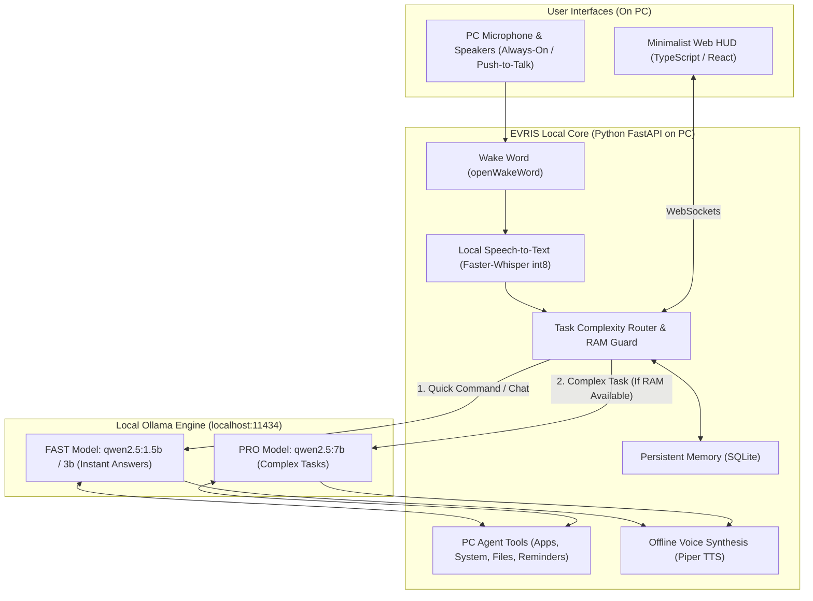

# E.V.R.I.S. — Master Architecture & Implementation Plan (PC Edition)

**E.V.R.I.S.** (*Environment for Voice, Robotics & Intelligent Systems*) is a 100% local, privacy-first personal AI assistant and autonomous PC agent inspired by **J.A.R.V.I.S.** from Iron Man, designed to run entirely on your computer (**Lenovo ThinkPad P16s Gen 2 — 16 GB RAM**).

---

## 1. Core Vision & Dual-Model PC Architecture

To get both **instant voice responsiveness** and **deep reasoning** within a **16 GB RAM** envelope on a Lenovo ThinkPad P16s Gen 2, Evris uses two local models managed by a **Complexity Router**:

1. **The "Fast" Model (`qwen2.5:1.5b-instruct` or `qwen2.5:3b-instruct`)**
   - **RAM Footprint**: `~1.1 GB – 1.9 GB`
   - **Role**: Default brain for 80% of interactions—voice commands, opening apps, controlling PC volume/media, timers, quick questions, and casual conversation.
   - **Why**: Responds almost instantaneously (`< 0.3s` time-to-first-token) and uses minimal battery/CPU so it can stay loaded in RAM all day while you work.
2. **The "Pro" Model (`qwen2.5:7b-instruct` Q4_K_M)**
   - **RAM Footprint**: `~4.7 GB`
   - **Role**: Activated automatically (or on command) for complex tasks—deep reasoning, coding, document analysis, summarization, and multi-step agent workflows.
   - **Memory Guardrail (16 GB RAM Safety)**: Before loading the Pro model, Evris checks available free RAM on your PC. If your PC is running heavy apps and free memory is too low to load the 7B model safely without swapping, Evris informs you that the Pro model cannot be loaded right now.

---

## 2. Target Hardware Sizing (Lenovo ThinkPad P16s Gen 2 — 16 GB RAM)

| Resource | Budget on 16 GB RAM | Engineering Design |
| :--- | :--- | :--- |
| **Windows OS + Your Apps** | `~6.0 – 8.0 GB` | Leaves `8.0 – 10.0 GB` of available RAM for Evris. |
| **Fast Model + Voice Pipeline** | `~1.8 GB` total | `qwen2.5:1.5b` (`1.1 GB`) + `Faster-Whisper int8` (`450 MB`) + `Piper TTS` (`150 MB`). Runs effortlessly in the background. |
| **Pro Model (On-Demand)** | `~4.7 GB` (`qwen2.5:7b`) | Ollama unloads the Pro model automatically after `5 minutes` of inactivity (`keep_alive: 5m`) to free your RAM back up. |

---

## 3. System Architecture & Request Flow



### How the Router Works (`router.py`)
1. **Fast Path (Default)**:
   - Short questions, PC commands (*"Open calculator"*, *"Mute volume"*, *"What's my CPU/RAM usage?"*, *"Set a reminder"*), and normal conversation are routed to the **Fast Model** for sub-second voice replies.
2. **Pro Path (Complex Tasks)**:
   - Triggered automatically for complex prompts (coding, debugging, long text analysis, multi-step planning) or when you explicitly ask (*"Use the Pro model..."* / *"Analyze in depth..."*).
   - **Check**: Verifies that Ollama and sufficient system RAM are available; if not, Evris clearly tells you that the Pro model cannot be executed right now.

---

## 4. Technology Stack (100% Local on Your PC)

| Layer | Technology | Rationale |
| :--- | :--- | :--- |
| **LLM Runtime** | **Ollama** | Manages both `qwen2.5:1.5b` (Fast) and `qwen2.5:7b` (Pro) locally with automatic memory unloading (`keep_alive`). |
| **Wake Word** | **openWakeWord** | Lets you wake Evris hands-free on your PC using `< 2%` CPU. |
| **Speech-to-Text (STT)** | **Faster-Whisper** (`base` / `small` `int8`) | Fast, accurate offline transcription of your microphone input. |
| **Text-to-Speech (TTS)** | **Piper TTS** | Instant, 100% offline neural voice synthesis with near-zero RAM/CPU usage. |
| **Backend & Agent** | **Python 3.12 + FastAPI + WebSockets** | Orchestrates the Fast/Pro router, SQLite memory, voice pipeline, and PC tools. |
| **Memory** | **SQLite** (`evris_memory.db`) | Single-file local database storing conversation history, user preferences, and reminders. |
| **Minimalist UI** | **React + TypeScript + Vite** | Distraction-free single-screen interface: Voice Orb, Chat stream, and Active Model (`FAST` vs `PRO`) indicator. |

---

## 5. Clean Repository Structure (`c:\Projets\Evris`)

```text
c:\Projets\Evris\
├── PROJECT_PLAN.md              # Master architecture & roadmap document
├── README.md                    # Quick-start guide
├── .gitignore
│
├── backend/                     # Python Backend & AI Core
│   ├── requirements.txt
│   └── app/
│       ├── main.py              # FastAPI server & WebSocket hub
│       ├── config.py            # Model names, RAM thresholds & voice settings
│       ├── core/
│       │   ├── router.py        # Complexity Classifier (Fast vs. Pro + Availability Check)
│       │   ├── agent.py         # J.A.R.V.I.S. persona, system prompt & tool execution loop
│       │   └── memory.py        # SQLite conversation history & long-term memory
│       ├── voice/
│       │   ├── wakeword.py      # openWakeWord listener
│       │   ├── stt.py           # Faster-Whisper local microphone transcription
│       │   └── tts.py           # Piper offline neural speech synthesis
│       └── tools/
│           ├── pc_control.py    # Launch apps, volume/media control, CPU/RAM/Battery stats
│           └── memory_tools.py  # Save/recall long-term facts, notes & timers
│
└── frontend/                    # Minimalist Web UI (React + TypeScript + Vite)
    ├── package.json
    ├── vite.config.ts
    └── src/
        ├── main.tsx
        ├── App.tsx              # Voice orb + chat stream + Fast/Pro mode indicator
        └── index.css
```

---

## 6. Step-by-Step Implementation Roadmap

1. **Phase 1 — Core Brain, Fast/Pro Router & Minimalist UI**
   - Build `backend/app/core/` (`router.py`, `agent.py`, `memory.py`) with automatic **Fast (`qwen2.5:1.5b` / `3b`)** vs. **Pro (`qwen2.5:7b`)** routing and availability checks.
   - Build the clean, minimalist `frontend/` interface (Voice Orb + Chat + Fast/Pro selector & status).
2. **Phase 2 — 100% Local Voice Pipeline (STT + TTS + Wake Word)**
   - Integrate `Faster-Whisper` (microphone transcription), `Piper TTS` (offline voice output), and `openWakeWord` (hands-free activation).
3. **Phase 3 — PC Control & Autonomous Agent Tools**
   - Add real PC tools in `backend/app/tools/`: opening/closing applications, system volume/media control, reading/summarizing local files, timers, and persistent memory commands.
4. **Phase 4 — Future Expansion (Optional Raspberry Pi Satellite)**
   - Because the Fast and Pro models are cleanly separated in `router.py`, moving the Fast model to a dedicated Raspberry Pi in the future will only require changing one URL in `config.py`.
