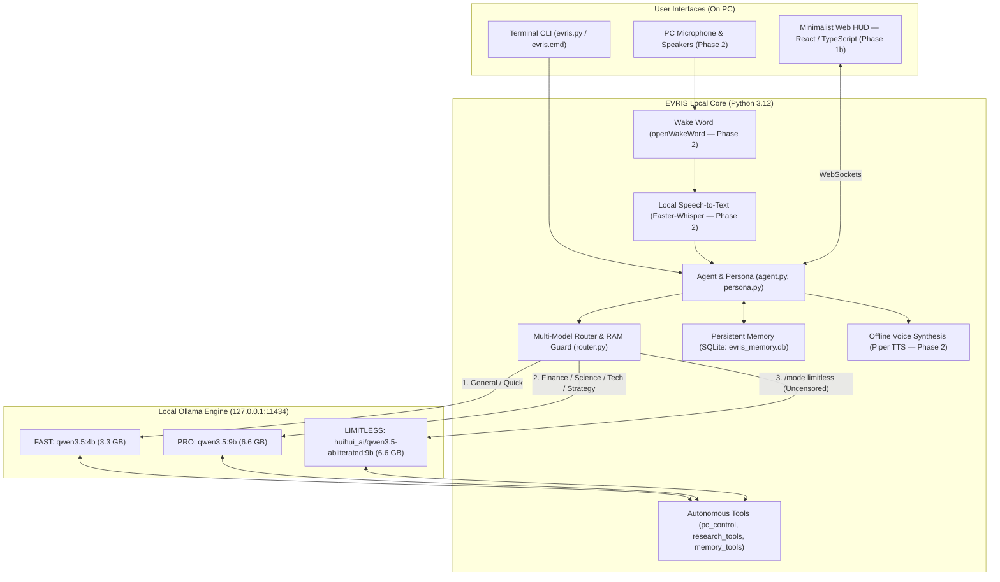

# E.V.R.I.S. — Master Architecture & Implementation Plan (PC Edition)

**E.V.R.I.S.** (*Environment for Voice, Robotics & Intelligent Systems*) is a 100% local, privacy-first personal AI assistant and autonomous PC agent inspired by **J.A.R.V.I.S.**, running entirely on your Windows workstation (**32 GB RAM · NVIDIA GeForce RTX 5060 Laptop GPU 8 GB VRAM · 8-core / 16-thread AMD CPU**).

---

## 1. Core Vision & Multi-Model PC Architecture

To combine **low-latency responses**, **deep domain reasoning**, and **unrestricted answers** locally on an **8 GB VRAM / 32 GB RAM** machine, Evris routes requests across three **Qwen 3.5** models via Ollama (`router.py`):

1. **The "Fast" Model (`qwen3.5:4b`)**
   - **Size**: `~3.3 GB` (fits comfortably in GPU VRAM with room to spare)
   - **Role**: Default brain for everyday conversation, quick questions, and simple PC actions (`keep_alive: 30m`, `think: false`).
   - **Why**: Low latency and minimal resource overhead so it can stay warm in memory during normal work.
2. **The "Pro" Model (`qwen3.5:9b`)**
   - **Size**: `~6.6 GB` (fits inside the 8 GB RTX 5060 VRAM)
   - **Role**: Activated automatically (by domain/complexity) or via `/mode pro` for deep reasoning across **Finance, Science, Computer Science, and Strategy**, coding, file analysis, and multi-step tool workflows (`keep_alive: 5m`).
   - **Memory Guardrail**: Before loading a 9B model, Evris checks effective available system RAM (`pro_min_free_ram_gb = 5.5 GB`, configurable via `/ram [gb]`). If free RAM is below threshold, Evris refuses cleanly rather than forcing Windows to swap.
3. **The "Limitless" Model (`huihui_ai/qwen3.5-abliterated:9b`)**
   - **Size**: `~6.6 GB` (abliterated / refusal-removed Qwen 3.5 9B)
   - **Role**: Activated explicitly via `/mode limitless` for unrestricted, uncensored responses without safety refusals, disclaimers, or moralizing, while keeping native tool calling and the same RAM safety guardrail (`keep_alive: 5m`).

---

## 2. Target Hardware Sizing (32 GB RAM + RTX 5060 8 GB VRAM)

| Resource | Budget on Workstation | Engineering Design |
| :--- | :--- | :--- |
| **Windows OS + User Apps** | `~10.0 – 18.0 GB` RAM | Leaves `~12.0 – 20.0 GB` RAM headroom on 32 GB total memory. |
| **GPU VRAM (RTX 5060)** | `8.0 GB` VRAM | Both `qwen3.5:4b` (`3.3 GB`) and `qwen3.5:9b` / `abliterated:9b` (`6.6 GB`) fit in VRAM for GPU-accelerated inference. |
| **Fast Model + Voice Pipeline *(Phase 2)*** | `~3.9 GB` total | `qwen3.5:4b` (`3.3 GB`) + `Faster-Whisper int8` (`~450 MB`) + `Piper TTS` (`~150 MB`). |
| **Heavy Models (On-Demand)** | `~6.6 GB` (`9b` / `abliterated:9b`) | Ollama auto-unloads `PRO` and `LIMITLESS` after `5 minutes` (`keep_alive: 5m`) to free VRAM/RAM when idle. |

---

## 3. System Architecture & Request Flow



### How the Router Works (`backend/app/core/router.py`)
1. **Auto Mode (`/mode auto`, default)**:
   - **Fast Path**: Short general prompts are routed to `qwen3.5:4b` (`think: false`) for snappy bilingual (FR/EN) replies.
   - **Pro Path**: Triggered automatically when a domain matches (`finance`, `science`, `tech`, `strategy`) or complexity triggers/long prompts appear (`> 140` chars, code blocks, analytical keywords).
2. **Manual Overrides**:
   - `/mode fast` forces `qwen3.5:4b`.
   - `/mode pro` forces `qwen3.5:9b`.
   - `/mode limitless` forces `huihui_ai/qwen3.5-abliterated:9b` with uncensored persona framing.
3. **Safety & Offline Guardrails**:
   - Verifies Ollama reachability, local model installation, `/pro on|off` state, and `pro_min_free_ram_gb` (`5.5 GB`) before running `9B` models.
   - Tool execution supports up to 3 rounds per prompt with `num_ctx: 8192` and `pro_thinking: false` by default for reliable, fast tool calling.

---

## 4. Technology Stack (100% Local on Your PC)

| Layer | Technology | Status / Rationale |
| :--- | :--- | :--- |
| **LLM Runtime** | **Ollama** (`qwen3.5:4b`, `qwen3.5:9b`, `huihui_ai/qwen3.5-abliterated:9b`) | **Implemented.** Native tool calling, VRAM/RAM offloading, and `keep_alive` management. |
| **Backend & Agent** | **Python 3.12 + httpx + psutil** (`FastAPI + Uvicorn` in deps) | **Core implemented** (`evris.py` CLI live; `FastAPI` WebSocket server planned). |
| **Memory** | **SQLite** (`backend/data/evris_memory.db`) | **Implemented.** Stores conversation history and permanent user facts/preferences. |
| **Autonomous Tools** | **PC, Research & Memory Tools** (`backend/app/tools/`) | **Implemented.** Unrestricted app launcher (PATH, Start Menu, URI, App Paths, URLs), system report, file/dir inspection, AST math, Yahoo Finance quotes, DuckDuckGo search, long-term memory. |
| **Minimalist Web UI** | **React + TypeScript + Vite** | **Planned (Phase 1b).** Voice Orb, chat stream, and `AUTO / FAST / PRO / LIMITLESS` indicator. |
| **Wake Word** | **openWakeWord** | **Planned (Phase 2).** Hands-free activation on PC (`< 2%` CPU). |
| **Speech-to-Text (STT)** | **Faster-Whisper** (`int8`) | **Planned (Phase 2).** Accurate offline microphone transcription. |
| **Text-to-Speech (TTS)** | **Piper TTS** | **Planned (Phase 2).** Fast offline neural voice synthesis. |

---

## 5. Repository Structure (`c:\Projets\Evris`)

```text
c:\Projets\Evris\
├── PROJECT_PLAN.md              # Master architecture & roadmap document
├── README.md                    # Quick-start guide & command reference
├── evris.py                     # Interactive Terminal CLI (REPL + slash commands)
├── evris.cmd                    # Windows launcher shortcut
├── .gitignore
│
├── docs/
│   └── evris-terminal.svg       # Terminal interface preview
│
├── backend/                     # Python Backend & AI Core
│   ├── requirements.txt
│   ├── data/
│   │   └── evris_memory.db      # SQLite conversation history & long-term memory
│   └── app/
│       ├── config.py            # Qwen 3.5 models, thinking toggle & RAM threshold
│       ├── main.py              # [Planned] FastAPI server & WebSocket hub
│       ├── core/
│       │   ├── router.py        # Fast / Pro / Limitless router, RAM guard & tool loop
│       │   ├── agent.py         # Direct pre-hooks, language priming & orchestration
│       │   ├── persona.py       # J.A.R.V.I.S. & Limitless persona + domain prompts
│       │   └── memory.py        # SQLite conversation history & long-term memory store
│       ├── tools/
│       │   ├── registry.py      # Ollama tool schemas & dispatcher (8 tools)
│       │   ├── pc_control.py    # Unrestricted app launcher, system report, files/dirs
│       │   ├── research_tools.py# Safe AST math, market quotes, DuckDuckGo web search
│       │   └── memory_tools.py  # Save/list long-term facts
│       └── voice/               # [Planned] Phase 2 local voice pipeline
│           ├── wakeword.py      # openWakeWord listener
│           ├── stt.py           # Faster-Whisper microphone transcription
│           └── tts.py           # Piper offline neural speech synthesis
│
└── frontend/                    # [Planned] Minimalist Web UI (React + TypeScript + Vite)
    ├── package.json
    ├── vite.config.ts
    └── src/
        ├── main.tsx
        ├── App.tsx              # Voice orb + chat stream + mode indicator
        └── index.css
```

---

## 6. Step-by-Step Implementation Roadmap

1. **Phase 1a — Core Brain, Multi-Model Router & Terminal CLI *(Done)***
   - Built `backend/app/core/` (`router.py`, `agent.py`, `persona.py`, `memory.py`) with **Qwen 3.5** (`qwen3.5:4b` Fast, `qwen3.5:9b` Pro, `huihui_ai/qwen3.5-abliterated:9b` Limitless), RAM safety guardrail, and native Ollama tool calling.
   - Built the interactive terminal interface (`evris.py` / `evris.cmd`) with `/mode`, `/pro`, `/ram`, `/memories`, `/forget`, `/tools`, `/status`, `/clear`.
   - Implemented core tools: unrestricted `open_application`, `get_system_report`, `read_local_file`, `list_directory`, `save_memory`, `calculate_math`, `get_market_quote`, and `web_search`.
2. **Phase 1b — FastAPI WebSocket Backend & Minimalist Web HUD *(Next)***
   - Build `backend/app/main.py` (FastAPI + WebSocket API exposing chat, telemetry, memories, and mode switching).
   - Build `frontend/` (React + TypeScript + Vite) with Voice Orb, live chat stream, tool execution badges, and `FAST / PRO / LIMITLESS` status indicator.
3. **Phase 2 — 100% Local Voice Pipeline (STT + TTS + Wake Word)**
   - Integrate `Faster-Whisper` (microphone transcription), `Piper TTS` (offline voice output), and `openWakeWord` (hands-free activation).
4. **Phase 3 — Extended PC Control & Automation Tools**
   - Add system volume/media controls, active timers/reminders, and guarded file/command workflows in `backend/app/tools/`.
5. **Phase 4 — Future Expansion (Optional Raspberry Pi Satellite)**
   - Because `fast_model`, `pro_model`, and `limitless_model` are cleanly decoupled in `router.py`, offloading a lightweight voice/Fast node to a Raspberry Pi later only requires pointing to a remote endpoint in `config.py`.
