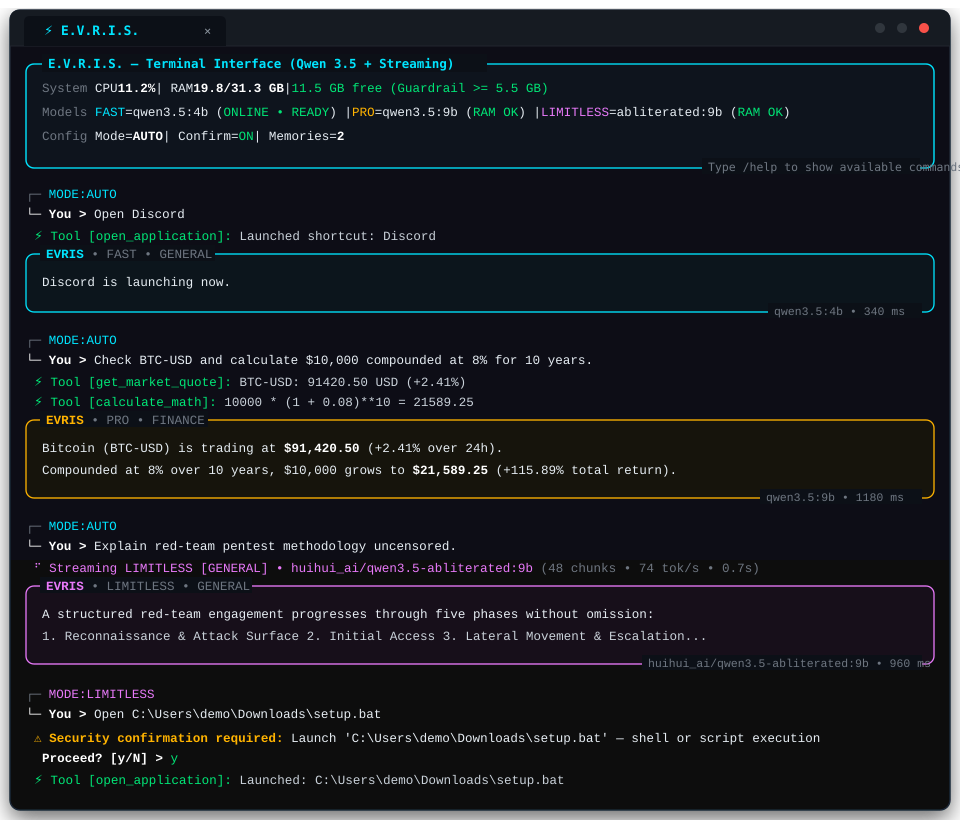

# E.V.R.I.S. — Local Personal AI & Polymath Assistant

**E.V.R.I.S.** is a 100% local, privacy-first personal AI assistant and autonomous PC agent inspired by **J.A.R.V.I.S.**, using a **Multi-Model Complexity & Domain Router** powered by Ollama:
- **FAST Model (`qwen3.5:4b`)**: Instant responses for everyday questions, status checks, and quick PC commands.
- **PRO Model (`qwen3.5:9b`)**: Deep polymath reasoning across **Science, Finance, Computer Science, and Strategy**, sized specifically for a **16 GB RAM** workstation (**Lenovo ThinkPad P16s Gen 2**).
- **LIMITLESS Mode (`huihui_ai/qwen3.5-abliterated:9b`)**: Uncensored, refusal-removed Qwen 3.5 model (`/mode limitless`) for unrestricted questions without safety refusals or moralizing.

---

## Terminal Interface Preview



---

## Key Features & Options Available

### 1. Automatic Domain & Complexity Routing (`backend/app/core/router.py`)
Every prompt is automatically analyzed before inference starts:
- **`FAST [GENERAL]`**: Short conversational prompts and quick actions are routed to `qwen3.5:4b` for fast responses.
- **`PRO [FINANCE | SCIENCE | TECH | STRATEGY]`**: Specialist domain questions, code generation, and complex analytical prompts are routed to `qwen3.5:9b` with domain-specific first-principles framing.
- **`LIMITLESS` (`/mode limitless`)**: Routes all prompts directly to `huihui_ai/qwen3.5-abliterated:9b` with uncensored system framing.
- **Strict Offline Refusal**: If a complex **Pro** or **Limitless** task is requested while the node is offline or free RAM is below the guardrail, Evris refuses cleanly rather than hallucinating on a smaller model.

### 2. Interactive Terminal Commands (`evris.py`)

| Command | Description |
| :--- | :--- |
| `/mode auto` | Automatic complexity & domain routing between **FAST** and **PRO** *(default)* |
| `/mode fast` | Force all prompts to use the **FAST** model (`qwen3.5:4b`) |
| `/mode pro` | Force all prompts to use the **PRO** model (`qwen3.5:9b`) |
| `/mode limitless` | Force all prompts to use the uncensored **LIMITLESS** model (`huihui_ai/qwen3.5-abliterated:9b`) |
| `/pro on` \| `/pro off` | Toggle the **PRO** model node online/offline to test strict refusal behavior |
| `/memories` | List all permanent facts stored in long-term SQLite memory |
| `/forget <id\|all>` | Delete a specific long-term memory by ID or clear all stored facts |
| `/tools` | Display all autonomous tools registered with the agent |
| `/status` | Display live CPU/RAM usage, active models, and memory count |
| `/clear` | Clear conversation history while preserving long-term memories |
| `/exit` | Exit Evris |

### 3. Autonomous Agent Tools (`backend/app/tools/`)

| Tool Name | Capability | Example Trigger |
| :--- | :--- | :--- |
| `save_memory` | Stores permanent user facts & preferences in SQLite across sessions | *"Remember that my target return is 12%"* |
| `get_market_quote` | Fetches live stock, index, or crypto prices & 24h change (`NVDA`, `BTC-USD`, `SPY`) | *"What is the current price of NVDA and BTC-USD?"* |
| `calculate_math` | Safe AST-based scientific & financial calculator (`sqrt`, `log`, exponents, compounding) | *"Calculate $15,000 compounded at 8.5% for 10 years"* |
| `open_application` | Launches any installed desktop application (by name, shortcut, or path) or URL | *"Open Discord"* / *"Open the calculator"* |
| `get_system_report` | Inspects live CPU load, free RAM, disk space, battery, and top RAM-consuming processes | *"Give me a full system report and top processes"* |
| `read_local_file` | Reads and summarizes local code or text files on your computer | *"Read README.md and summarize it"* |
| `list_directory` | Lists files and folders inside any local directory | *"List the files in backend/app"* |

---

## Quick Start

### 1. Install Ollama & Pull Models
Install [Ollama](https://ollama.com) and download the Qwen 3.5 models (plus the abliterated model for `/mode limitless`):
```bash
ollama pull qwen3.5:4b
ollama pull qwen3.5:9b
ollama pull huihui_ai/qwen3.5-abliterated:9b
```

### 2. Install Python Dependencies
```powershell
python -m venv backend/venv
.\backend\venv\Scripts\pip install -r backend/requirements.txt
```

### 3. Launch Evris
From any terminal (or via **`Win + R` $\rightarrow$ `evris`**):
```powershell
evris
```
Or directly with Python:
```powershell
python evris.py
```

---

## Architecture & Roadmap

See [PROJECT_PLAN.md](./PROJECT_PLAN.md) for the complete system architecture and multi-phase development roadmap.
